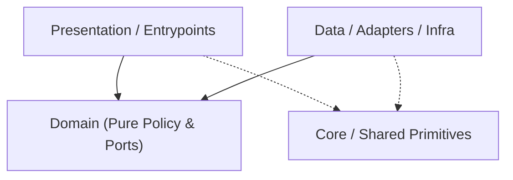

# Codebase Architecture Map — `adb-agent`

> Auto-generated by `project-pro map` (2026-10-31 05:51 UTC). Read this first to save exploration tokens.
- **Detected Stack**: `android` | **Mode**: `configured`

## 1. Canonical Layer Dependency Flow

## 2. Layer Distribution (Code Files)
- **Domain**: `10` | **Data/Infra**: `13` | **Presentation/UI**: `16` | **Core/Shared**: `4` | **Tests**: `4` | **Other**: `18`

## 3. Module / Directory Index (Top Slices)
- `./` — `2` files (`23` LOC)
- `app/` — `1` files (`95` LOC)
- `app/src/main/` — `55` files (`5245` LOC)
- `app/src/test/` — `4` files (`450` LOC)
- `scripts/` — `3` files (`363` LOC)

## 4. Key Contracts & Entry Interfaces
- `AdbDiscoveryGateway` (`app/src/main/kotlin/app/duinch/adbagent/features/pairing/domain/AdbPairingGateway.kt`)
- `AdbPairingState` (`app/src/main/kotlin/app/duinch/adbagent/features/pairing/domain/WirelessAdbEndpoint.kt`)
- `PairingUiIntent` (`app/src/main/kotlin/app/duinch/adbagent/features/pairing/presentation/PairingContract.kt`)
- `TermuxRuntimeGateway` (`app/src/main/kotlin/app/duinch/adbagent/features/termux/domain/TermuxRuntimeGateway.kt`)
- `TermuxUiIntent` (`app/src/main/kotlin/app/duinch/adbagent/features/termux/presentation/TermuxContract.kt`)
- `Frame` (`app/src/main/kotlin/app/duinch/adbagent/features/tunnel/data/TunnelStreamProtocol.kt`)
- `HostActivityRepository` (`app/src/main/kotlin/app/duinch/adbagent/features/tunnel/domain/HostActivityRepository.kt`)
- `TunnelConfigRepository` (`app/src/main/kotlin/app/duinch/adbagent/features/tunnel/domain/TunnelGateways.kt`)
- `TunnelConnectionState` (`app/src/main/kotlin/app/duinch/adbagent/features/tunnel/domain/TunnelModels.kt`)
- `DashboardUiIntent` (`app/src/main/kotlin/app/duinch/adbagent/features/tunnel/presentation/DashboardContract.kt`)
- `UpdateStatus` (`app/src/main/kotlin/app/duinch/adbagent/features/updater/domain/AppReleaseModels.kt`)
- `AppUpdateGateway` (`app/src/main/kotlin/app/duinch/adbagent/features/updater/domain/AppUpdateGateway.kt`)
- `UpdaterUiIntent` (`app/src/main/kotlin/app/duinch/adbagent/features/updater/presentation/UpdaterContract.kt`)
