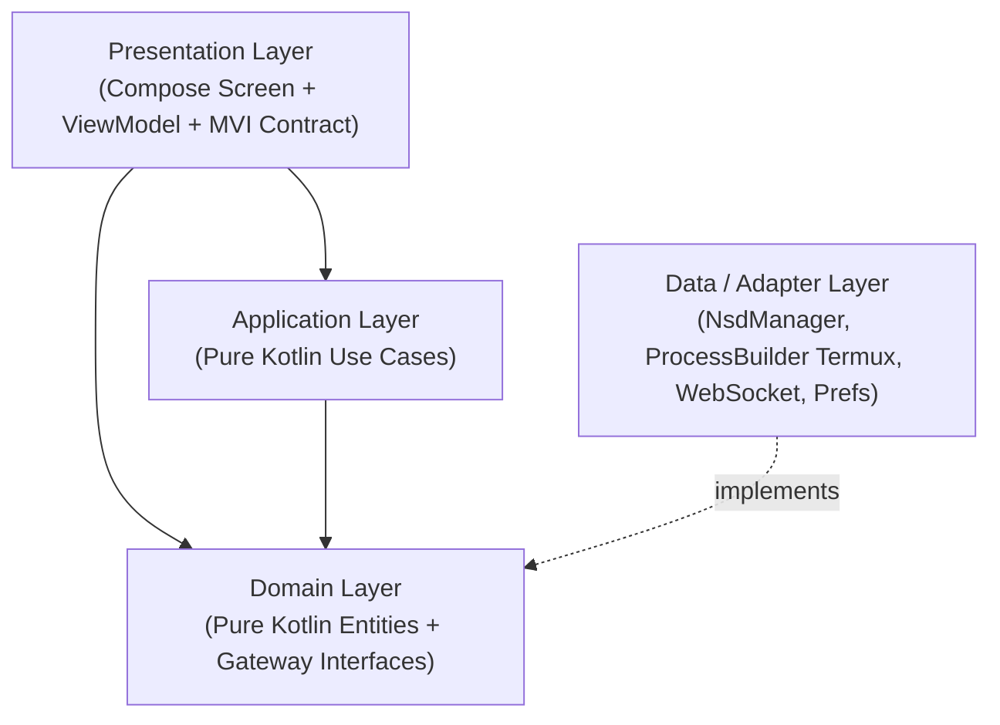
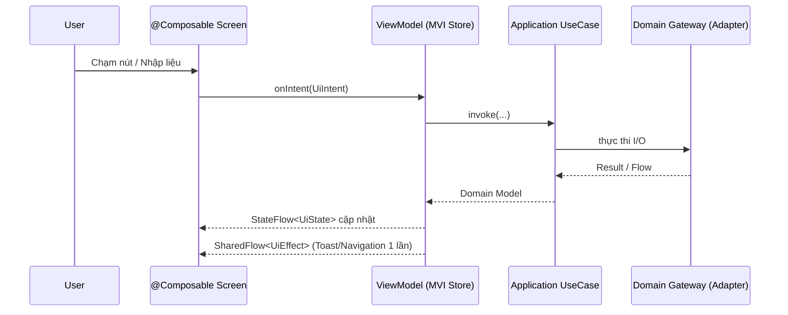

# Software Architecture (`ARCHITECTURE.md`)

## 1. Mô hình Kiến trúc: Feature-First + Clean Architecture + MVI

Dự án áp dụng nguyên tắc **Dependency Rule** của Clean Architecture kết hợp tổ chức thư mục **Feature-First** và mô hình trình diễn một chiều **MVI (Model – View – Intent)**.

### Quy tắc Phụ thuộc (Dependency Direction)
- **`domain`**: Không phụ thuộc bất kỳ tầng nào khác. Thuần Kotlin (`kotlin.*`, `kotlinx.coroutines.flow.*`).
- **`application`**: Chỉ phụ thuộc `domain` (và `core/model`). Chứa logic điều phối nghiệp vụ.
- **`presentation`**: Phụ thuộc `application` và `domain`. Quản lý trạng thái bất biến `*UiState`, xử lý `*UiIntent` và phát `*UiEffect`.
- **`data`**: Phụ thuộc `domain` để hiện thực hóa các Gateway/Repository bằng Android SDK (`NsdManager`, `ForegroundService`), `ProcessBuilder` (Termux prefix) và OkHttp WebSocket.
- **`core/di`**: Nơi duy nhất lắp ghép (wiring) các implementation của `data` vào `application` Use Cases và `ViewModel`.

---

## 2. Phân rã theo Feature (Feature-First)

1. **`features/pairing`**:
   - Quét mDNS tìm cổng `_adb-tls-pairing._tcp` và `_adb-tls-connect._tcp`.
   - Kiểm tra tính hợp lệ của mã ghép nối 6 chữ số và thực thi ghép đôi TLS nội bộ.
2. **`features/termux`**:
   - Quản lý vòng đời thư mục môi trường nhúng Termux (`$PREFIX = filesDir/usr`, `$HOME = filesDir/home`).
   - Cung cấp sandbox chạy lệnh POSIX/ADB và truyền luồng stdout/stderr lên Console Sheet.
3. **`features/tunnel`**:
   - Duy trì kết nối Reverse WebSocket từ điện thoại lên `wss://adb.duinch.app/api/tunnel`.
   - Tính toán chiến lược Exponential Backoff có Jitter khi chuyển vùng Wi-Fi ↔ 4G/5G.
   - Điều phối màn hình chính `DashboardScreen` hợp nhất trạng thái toàn hệ thống.

---

## 3. Luồng MVI một chiều (Unidirectional Data Flow)

